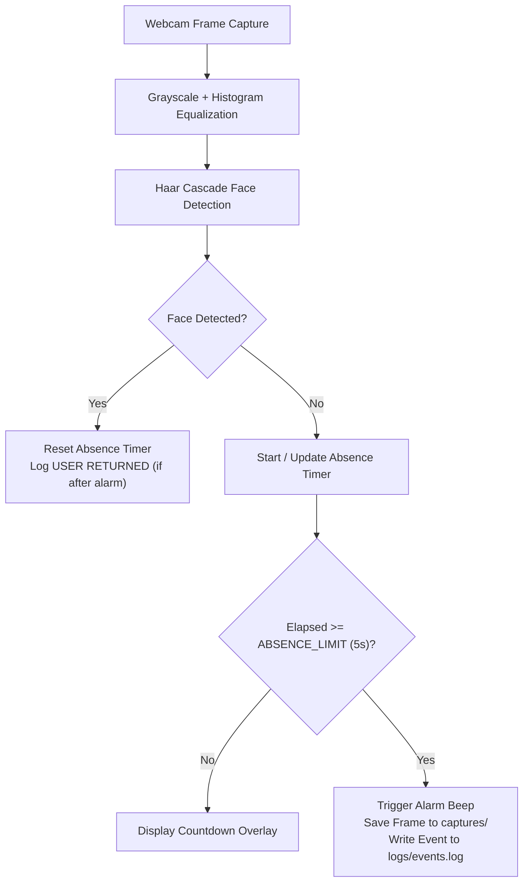

<p align="right"><a href="README.md">TR</a> | <b>EN</b></p>

# 👁️ OpenCV Smart Presence Monitor

<p>
  
  
  
</p>

A real-time user presence monitoring application built with **Python** and **OpenCV**.

The application continuously monitors the webcam feed, detects whether a user is present using a **Haar Cascade Frontal Face Classifier**, and triggers an alarm if no face is detected for a configurable timeout period. During an alarm event, the current camera frame is automatically captured and all key events are logged with timestamps.

---

## 🚀 Project Overview

This project demonstrates how classical computer vision techniques can be used to build a lightweight, real-time presence monitoring system.

Instead of identifying **who** the user is (face recognition), the application determines **whether a face is present** in the camera view (face detection).

When the user remains absent for a predefined threshold (`ABSENCE_LIMIT = 5` seconds by default), the system automatically:

* Triggers an audible alarm (`winsound` on Windows, terminal bell fallback on Linux/macOS)
* Captures a timestamped screenshot of the current frame (`captures/`)
* Records the event in a structured log file (`logs/events.log`)
* Detects when the user returns and logs the return event

---

## ✨ Features

* ✅ Real-time webcam monitoring with mirrored display
* ✅ Face detection using Haar Cascade Classifier (`equalizeHist` pre-processing)
* ✅ Configurable absence countdown timer (`ABSENCE_LIMIT`)
* ✅ Audible alarm notification on timeout
* ✅ Automatic screenshot capture (`captures/alarm_YYYY-MM-DD_HH-MM-SS.jpg`)
* ✅ Timestamped event logging (`APPLICATION STARTED`, `ALARM`, `USER RETURNED`, `APPLICATION CLOSED`)
* ✅ Live HUD overlay: status indicator, face count, alarm counter, last alarm timestamp, and session uptime

---

## 🔄 How It Works



---

## 🛠️ Technologies & OpenCV Concepts

* **Python 3** (`datetime`, `time`, `os`, `winsound`)
* **OpenCV (`cv2`)**:
  * Real-time video stream (`cv2.VideoCapture`)
  * Grayscale conversion & histogram equalization (`cv2.cvtColor`, `cv2.equalizeHist`)
  * Multi-scale Haar Cascade detection (`cv2.CascadeClassifier.detectMultiScale`)
  * Real-time HUD rendering (`cv2.rectangle`, `cv2.putText`, `cv2.getTextSize`)
  * Automatic frame persistence (`cv2.imwrite`)

---

## 📁 Project Structure

```text
opencv-smart-presence-monitor/
├── captures/
│   └── .gitkeep                             # Alarm screenshots saved here
├── logs/
│   └── .gitkeep                             # Timestamped events.log written here
├── .gitignore
├── haarcascade_frontalface_default.xml      # OpenCV Haar Cascade frontal face model
├── main.py                                  # Main application entry point
├── requirements.txt
├── LICENSE
├── README.md                                # Turkish documentation (default)
└── README.en.md                             # English documentation
```

---

## ⚙️ Installation & Usage

```bash
git clone https://github.com/umutkilictas/opencv-smart-presence-monitor.git
cd opencv-smart-presence-monitor
pip install -r requirements.txt
python main.py
```

Press **`Q`** in the video window to exit the application cleanly.

---

## 📋 Example Event Log (`logs/events.log`)

```text
[2026-08-05 16:45:13] APPLICATION STARTED
[2026-08-05 16:46:02] ALARM - User Missing | Capture: captures/alarm_2026-08-05_16-46-02.jpg
[2026-08-05 16:46:14] USER RETURNED
[2026-08-05 16:48:31] APPLICATION CLOSED
```

---

## ⚠️ Current Limitations

* Performs **face detection**, not identity-specific **face recognition**.
* Detection accuracy depends on ambient lighting and frontal head pose.

---

## 🙏 Acknowledgements & License

Uses the official [OpenCV Haar Cascade Frontal Face Classifier](https://github.com/opencv/opencv/tree/master/data/haarcascades).  
Licensed under the [MIT License](LICENSE).
