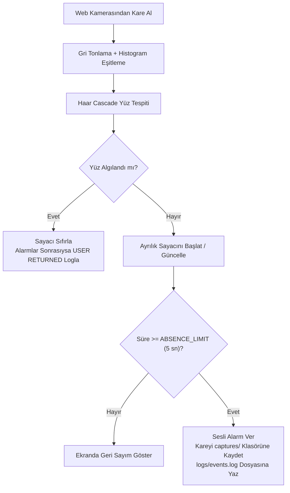

<p align="right"><b>TR</b> | <a href="README.en.md">EN</a></p>

# 👁️ OpenCV Akıllı Varlık Takip Sistemi (Smart Presence Monitor)

<p>
  
  
  
</p>

**Python** ve **OpenCV** kullanılarak geliştirilmiş gerçek zamanlı kullanıcı varlık takip uygulaması.

Uygulama web kamerası görüntüsünü sürekli olarak izler, **Haar Cascade Yüz Sınıflandırıcısı** ile kamerada bir yüz olup olmadığını tespit eder ve belirlenen süre boyunca kullanıcı algılanmazsa otomatik olarak alarm verir. Alarm anında kamera görüntüsünü kaydeder ve tüm önemli olayları zaman damgasıyla log dosyasına yazar.

---

## 🚀 Proje Özeti

Bu proje, klasik bilgisayarlı görü (computer vision) teknikleriyle hafif ve gerçek zamanlı bir varlık izleme sisteminin nasıl kurulabileceğini gösterir.

Uygulama kullanıcının **kim olduğunu** (yüz tanıma) değil, kamera karşısında **bir yüzün bulunup bulunmadığını** (yüz tespiti) kontrol eder.

Kullanıcı önceden tanımlanan süre (`ABSENCE_LIMIT = 5` saniye) boyunca kamerada görünmezse sistem otomatik olarak:

* Sesli alarm verir (Windows'ta `winsound`, diğer işletim sistemlerinde terminal uyarısı)
* O anki kamera karesini ekran görüntüsü olarak kaydeder (`captures/`)
* Olayı zaman damgasıyla log dosyasına yazar (`logs/events.log`)
* Kullanıcı geri döndüğünde bunu algılar ve loglar

---

## ✨ Özellikler

* ✅ Gerçek zamanlı, aynalanmış web kamerası takibi
* ✅ Histogram eşitleme (`equalizeHist`) ön işlemeli Haar Cascade yüz tespiti
* ✅ Ayarlanabilir ayrılık geri sayım süresi (`ABSENCE_LIMIT`)
* ✅ Süre aşımında sesli alarm bildirimi
* ✅ Otomatik ekran görüntüsü kaydı (`captures/alarm_YYYY-MM-DD_HH-MM-SS.jpg`)
* ✅ Zaman damgalı olay günlüğü (`APPLICATION STARTED`, `ALARM`, `USER RETURNED`, `APPLICATION CLOSED`)
* ✅ Canlı ekran üstü bilgi paneli (HUD): durum göstergesi, algılanan yüz sayısı, toplam alarm sayacı, son alarm saati ve çalışma süresi

---

## 🔄 Çalışma Akışı



---

## 🛠️ Kullanılan Teknolojiler ve OpenCV Kavramları

* **Python 3** (`datetime`, `time`, `os`, `winsound`)
* **OpenCV (`cv2`)**:
  * Gerçek zamanlı video akışı (`cv2.VideoCapture`)
  * Gri tonlama dönüşümü ve histogram eşitleme (`cv2.cvtColor`, `cv2.equalizeHist`)
  * Çok ölçekli Haar Cascade nesne tespiti (`cv2.CascadeClassifier.detectMultiScale`)
  * Gerçek zamanlı HUD çizimi (`cv2.rectangle`, `cv2.putText`, `cv2.getTextSize`)
  * Olay anında görüntü kaydetme (`cv2.imwrite`)

---

## 📁 Proje Yapısı

```text
opencv-smart-presence-monitor/
├── captures/
│   └── .gitkeep                             # Alarm anında alınan ekran görüntüleri
├── logs/
│   └── .gitkeep                             # Zaman damgalı events.log dosyası
├── .gitignore
├── haarcascade_frontalface_default.xml      # OpenCV Haar Cascade ön yüz modeli
├── main.py                                  # Ana uygulama kodu
├── requirements.txt
├── LICENSE
├── README.md                                # Türkçe dokümantasyon (varsayılan)
└── README.en.md                             # İngilizce dokümantasyon
```

---

## ⚙️ Kurulum ve Kullanım

```bash
git clone https://github.com/umutkilictas/opencv-smart-presence-monitor.git
cd opencv-smart-presence-monitor
pip install -r requirements.txt
python main.py
```

Uygulamadan güvenli şekilde çıkmak için kamera penceresi aktifken **`Q`** tuşuna basın.

---

## 📋 Örnek Olay Günlüğü (`logs/events.log`)

```text
[2026-08-05 16:45:13] APPLICATION STARTED
[2026-08-05 16:46:02] ALARM - User Missing | Capture: captures/alarm_2026-08-05_16-46-02.jpg
[2026-08-05 16:46:14] USER RETURNED
[2026-08-05 16:48:31] APPLICATION CLOSED
```

---

## ⚠️ Mevcut Kısıtlamalar

* Uygulama kimlik doğrulaması (yüz tanıma) değil, **yüz varlık tespiti** yapar.
* Tespit başarımı ortam ışığına ve yüzün kameraya dönük olmasına bağlıdır.

---

## 🙏 Teşekkür ve Lisans

Bu projede resmi [OpenCV Haar Cascade Frontal Face Classifier](https://github.com/opencv/opencv/tree/master/data/haarcascades) modeli kullanılmıştır.  
Kaynak kodlar [MIT Lisansı](LICENSE) altında lisanslanmıştır.
